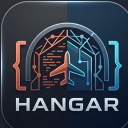
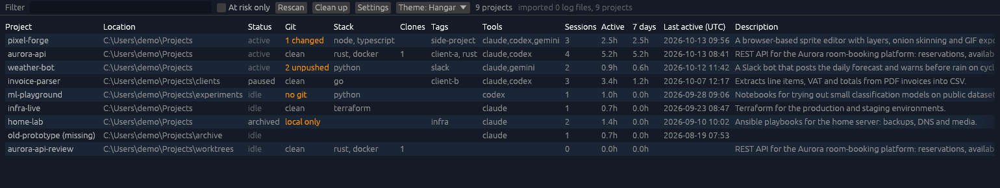

<p align="center"></p>

<h1 align="center">Hangar</h1>

<p align="center">
  <!-- CI -->
  <a href="https://github.com/evandervecht/hangar/actions/workflows/ci.yml">
    
  </a>
  <!-- Version -->
  <a href="https://github.com/evandervecht/hangar/releases">
    
  </a>
  <!-- License -->
  <a href="https://github.com/evandervecht/hangar/blob/main/LICENSE">
    
  </a>
  <!-- Docs -->
  <a href="https://diataxis.fr/">
    
  </a>
</p>
<p align="center">
  <!-- Issues -->
  <a href="https://github.com/evandervecht/hangar/issues">
    
  </a>
  <!-- Stars -->
  <a href="https://github.com/evandervecht/hangar/stargazers">
    
  </a>
  <!-- Forks -->
  <a href="https://github.com/evandervecht/hangar/network">
    
  </a>
  <!-- Sponsor -->
  <a href="https://github.com/sponsors/evandervecht?metadata_project=hangar">
    
  </a>
</p>
<p align="center">
  <!-- Stack -->
  
  
  
  
  
</p>

A CMDB for your AI coding projects. Hangar tracks where your Claude Code and Codex projects live, what they are, their git origin and the time you've spent in each. It's built in Rust for Windows and macOS.

<p align="center"></p>
<p align="center"><sub>Demo data, Hangar theme.</sub></p>

## What it does

- **Finds your projects** from the sessions Claude Code, Codex, Gemini CLI and Hermes Agent leave behind, plus git repos under your work folders.
- **Shows what each one is.** The description comes from the first paragraph of `README.md`, `CLAUDE.md` or `AGENTS.md`.
- **Shows where it lives and where it syncs to:** the path and the git origin, or "local only" / "no git".
- **Shows the time spent:** sessions, active time (total and the last 7 days, with idle gaps over 15 minutes left out) and when the project was last active.
- **Shows the state:** *active* or *idle* from recent activity, unless you set active / paused / archived yourself. You can also add tags and notes.
- **Flags work at risk:** uncommitted changes, unpushed commits, repos without a remote and folders without git, with an **At risk only** filter.
- **Links clones:** every checkout of the same repo is counted and listed, whatever the URL style.
- **Detects the stack:** rust, node, python, go, terraform and more, from the files in each project.
- **Never forgets:** a project whose folder is gone stays in the list, flagged *missing*. If it moved, merge it into its new location and keep its history.
- **Exports:** `hangar list --json` or `--csv` for spreadsheets and scripts.
- **Settings:** choose the project folders to scan and the paths to hide, right in the app.
- **Cleans up:** forget missing projects, hide noise, and move old AI session logs or whole project folders to the Recycle Bin / Trash.
- **Runs in the background:** optionally lives in the tray, rescans on a timer and starts at login.
- **Themes:** System, Dark, Light, or Hangar (navy with the logo's coral and cyan accents).

Everything stays on your machine. Hangar only reads the logs and writes its own local SQLite file.

## Install

**Download:** from [Releases](https://github.com/evandervecht/hangar/releases), grab `hangar-<version>-x86_64-pc-windows-msvc.exe` (or the zip) on Windows, or the tar.gz with `Hangar.app` on macOS. Bare macOS binaries are attached too. The binaries are unsigned; see [Make a release](docs/how-to/release.md#unsigned-binaries) for the first-launch step.

**From source:** you need a [Rust toolchain](https://rustup.rs).

```sh
git clone https://github.com/evandervecht/hangar.git
cd hangar
./install.ps1   # Windows: %LOCALAPPDATA%\Programs\hangar, Start Menu shortcut, adds to PATH
./install.sh    # macOS / Linux: ~/.local/bin (added to PATH), plus ~/Applications/Hangar.app on macOS
```

## Use

```
hangar          # open the window (scans on launch, Rescan button for more)
hangar scan     # import new sessions and print counts
hangar list     # print the project table
hangar list --json   # or --csv, for other tools
```

## Documentation

The docs follow [Diátaxis](https://diataxis.fr/); start at [docs/README.md](docs/README.md).

- **Tutorial:** [Getting started](docs/tutorials/getting-started.md)
- **How-to:** [Choose what Hangar scans](docs/how-to/configure-sources.md) · [Find projects at risk](docs/how-to/find-at-risk-projects.md) · [Merge a moved project](docs/how-to/merge-a-moved-project.md) · [Export](docs/how-to/export.md) · [Run in the background](docs/how-to/run-in-background.md) · [Check a download](docs/how-to/verify-download.md) · [Clean up](docs/how-to/clean-up.md) · [Change the theme](docs/how-to/change-theme.md) · [Make a release](docs/how-to/release.md) · [Add another AI tool](docs/how-to/add-an-ai-tool.md)
- **Reference:** [CLI](docs/reference/cli.md) · [Configuration](docs/reference/configuration.md) · [Project fields](docs/reference/project-fields.md) · [Sources](docs/reference/sources.md)
- **Explanation:** [How Hangar works](docs/explanation/how-hangar-works.md)

## Roadmap

Scope per version is in [SPEC.md](SPEC.md).

**Next:** a Windows installer and a macOS disk image (DMG), and signed releases.

**Maybe later**, still being thought through:

- **Cost per project:** tokens and spend per project and per week, across every AI tool: Claude Code, Codex, Cursor, Hermes, Gemini and others, which also means reading those tools' logs.
- **Change history:** a timeline per project of what changed and when (origin, status, moves).
- **Ownership:** an owner or client field, with hours per client.
- **Several machines:** one view across your Mac and Windows machines without any network connection, for example by exporting a file on one machine and importing it on the other.

## Support

Hangar is free and MIT-licensed. If it saves you time, you can [sponsor its development on GitHub](https://github.com/sponsors/evandervecht?metadata_project=hangar).

## Backers

Thank you to everyone who keeps Hangar flying.

<!-- Add Co-pilot, Flight Lead and Hangar Pass sponsors below, one per line: [@handle](https://github.com/handle) -->

*Be the first: [become a backer](https://github.com/sponsors/evandervecht?metadata_project=hangar).*

## License

[MIT](LICENSE)
